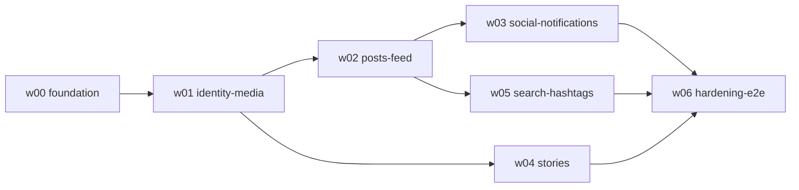

# Product Waves — insta-test (Instagram-like photo & video sharing)

Source of truth: approved spec tree [`docs/specs/`](../specs/README.md) (branch `spec/spn_01M7MK8KQS1TR68R1BC5N49ENS` → `main`).
Machine-readable plan: [`WAVE_MANIFEST.json`](./WAVE_MANIFEST.json). Per-wave briefs: [`waves/`](./waves/).

## 1. Goal

Ship a self-hosted Instagram-like app (feed, photo/video posts, profiles, follows, likes, comments, search, 24h stories, live notifications) as **7 waves** that run in parallel at two levels:

- **Inter-wave:** a `depends_on` DAG. Waves with no dependency path between them have pairwise disjoint `owned_paths` and run at the same time in separate git worktrees and separate compose port blocks.
- **Intra-wave:** every wave runs `WNN-01` (`contracts`) first, then parallel `worker` tasks with pairwise disjoint `owned_paths`, then `WNN-K` (`validate`).

## 2. Wave DAG

| Wave | Slug | Depends on | Runs concurrently with | Brief |
|---|---|---|---|---|
| `w00` | foundation | — | — | [W00-foundation.md](./waves/W00-foundation.md) |
| `w01` | identity-media | `w00` | — | [W01-identity-media.md](./waves/W01-identity-media.md) |
| `w02` | posts-feed | `w01` | `w04` | [W02-posts-feed.md](./waves/W02-posts-feed.md) |
| `w03` | social-notifications | `w02` | `w04`, `w05` | [W03-social-notifications.md](./waves/W03-social-notifications.md) |
| `w04` | stories | `w01` | `w02`, `w03`, `w05` | [W04-stories.md](./waves/W04-stories.md) |
| `w05` | search-hashtags | `w02` | `w03`, `w04` | [W05-search-hashtags.md](./waves/W05-search-hashtags.md) |
| `w06` | hardening-e2e | `w03`, `w04`, `w05` | — | [W06-hardening-e2e.md](./waves/W06-hardening-e2e.md) |

Critical path: `w00 → w01 → w02 → {w03 ∥ w05} → w06`. `w04` runs alongside `w02`, `w03` and `w05`.

**No stacking:** each wave branches `wave/wNN-<slug>` from `main` only after all its `depends_on` waves have landed (`wave-land`). Workers branch `issue/WNN-XX` from the wave branch after `WNN-01` is merged into it.

## 3. How disjointness is achieved

The app's shared files (composition root, route registry, page registry, typed API client, design system) are what would make parallel waves collide. **w00 builds or freezes all of them**, so feature waves only edit files of their own module.

| Shared touchpoint | Built/frozen in | Rule for later waves |
|---|---|---|
| `packages/contracts/src/**` (all DTOs, `errors.ts`, `ids.ts`, `limits.ts`, `pagination.ts`, `events.ts`) | `W00-01` | A wave's `contracts` task may edit only its module's `dto/<module>.ts` (and `events.ts` in w03), and only to fix drift from the spec. Any other change is recorded as a gap and done in w06. |
| `apps/api/migrations/0001_init.sql` (whole schema + every index) | `W00-01` | Feature waves add **no** migrations. `0002_hardening.sql` is the only other reserved number (`W06-01`, created only if a gap needs it). |
| `apps/api/src/main.ts` (composition root), `api/server.ts`, `api/auth.plugin.ts`, `api/sse/*` (except `subscriptions.ts`), `data/db`, `data/storage`, `jobs/index.ts`, `jobs/runner.ts` | `W00-02` | Read-only after w00. Every service and repository is constructed in `main.ts` against **stub classes with frozen constructors** that later waves fill in. |
| `api/routes/index.ts` (lists all 13 route modules) | `W00-01` | Each wave replaces only its own stub `api/routes/<module>.routes.ts`. |
| `domain/<module>/ports.ts`, entity/read-model types, service signatures, `data/rows/*.row.ts` | `W00-01` | The module's wave `contracts` task re-checks and finalizes them. |
| `apps/web/src/api/**` (complete typed client for every endpoint) | `W00-03` | Read-only after w00 (it is generated mechanically from frozen contracts). |
| `App.tsx` route table, `ui/pages/index.ts`, `ui/layout`, `ui/components/primitives`, `styles`, `state/session.ts`, `state/query-client.ts`, `state/form-errors.ts`, `state/mappers/common.ts` | `W00-01` / `W00-03` | Read-only after w00. |
| Cross-wave UI pieces: `posts/PostCard`, `posts/PostGrid`, `social/LikeButton`, `social/FollowButton`, `social/FollowListModal`, `social/CommentSection`, `stories/StoryTray`, `profile/ProfileHeader`, and hooks in `state/<module>.ts` | Stubs with **frozen props/signatures** in `W00-01` | The owning wave replaces the stub body and keeps the props/signature. Consumers in other waves import the stub until the owner lands. |
| Test fixtures | `apps/api/test/helpers/*` base in `W00-02`; `<module>-fixtures.ts` in each wave's `contracts` task | Fixtures insert rows with **raw SQL**, so sibling workers never depend on each other's services. |
| Gap ledgers | Each task writes `docs/questions-and-limitations/wNN-gaps-WNN-XX.md` | The `validate` task merges them into `wNN-gaps.md`, which `wave-land` compiles into `GAPS_AND_QUESTIONS.md`. |

Module file stems (fixed in w00): `user`, `session`, `media`, `post`, `comment`, `like`, `follow`, `story`, `notification`, `feed`, `search`. Route files: `auth`, `users`, `media`, `posts`, `feed`, `likes`, `comments`, `follows`, `notifications`, `stories`, `search`, `events`, `health`. Test dirs: `apps/api/test/{unit,integration}/<module>/`, `apps/web/test/<module>/`.

## 4. Ownership map of concurrent waves

| Area | w02 posts-feed | w03 social-notifications | w04 stories | w05 search-hashtags |
|---|---|---|---|---|
| Contracts | `dto/posts.ts` | `dto/comments.ts`, `dto/notifications.ts`, `dto/users.ts`, `events.ts` | `dto/stories.ts` | `dto/search.ts` |
| Domain | `domain/posts/{ports,post,post.service,hashtag}.ts`, `domain/feed` | `domain/posts/{like,like.service,comment,comment.service}.ts`, `domain/posts/ports.ts`, `domain/social`, `domain/notifications` | `domain/stories` | `domain/search` |
| Data | `post.*`, `post-view.query.ts`, `feed.pg-repository.ts` | `comment.*`, `like.*`, `follow.*`, `notification.*` | `story.*` | `search.*` |
| HTTP | `posts.routes.ts`, `feed.routes.ts`, `post.dto-mapper.ts` | `likes`/`comments`/`follows`/`notifications` routes + DTO mappers, `api/sse/subscriptions.ts` | `stories.routes.ts`, `story.dto-mapper.ts`, `jobs/story-cleanup.job.ts` | `search.routes.ts`, `search.dto-mapper.ts` |
| Web | `HomePage*`, `ExplorePage*`, `CreatePostPage*`, `PostPage*`, `components/posts`, `state/{posts,feed}.ts` | `NotificationsPage*`, `components/{social,notifications}`, `state/{social,comments,notifications,live}.ts` | `CreateStoryPage*`, `StoryViewerPage*`, `components/stories`, `state/stories.ts` | `SearchPage*`, `HashtagPage*`, `components/search`, `state/search.ts` |

`w02` and `w03` share `domain/posts/ports.ts`. That is allowed because `w03` depends on `w02` and never runs at the same time.

## 5. Per-wave compose isolation (ports)

Previews are rendered with the `wave-compose-deploy` skill. `slot_index` = wave number. Port block: `21000 + slot_index * 20`. `web` is at offset `+0` (`WEB_HOST_PORT`) and `api` at offset `+1` (`API_HOST_PORT`). `db` publishes no host port. Compose project: `yd-insta-wNN`.

| Wave | Slot | Port block | web | api |
|---|---|---|---|---|
| `w00` | 0 | 21000–21019 | 21000 | 21001 |
| `w01` | 1 | 21020–21039 | 21020 | 21021 |
| `w02` | 2 | 21040–21059 | 21040 | 21041 |
| `w03` | 3 | 21060–21079 | 21060 | 21061 |
| `w04` | 4 | 21080–21099 | 21080 | 21081 |
| `w05` | 5 | 21100–21119 | 21100 | 21101 |
| `w06` | 6 | 21120–21139 | 21120 | 21121 |

`PUBLIC_URL`, `PUBLIC_API_URL` and `CORS_ORIGIN` are derived from these ports, as described in [infra/01-docker-compose.md](../specs/infra/01-docker-compose.md#per-wave-port-blocks-wave_port_base). The spec's local default `WAVE_PORT_BASE = 18000 + NN*10` stays valid for hand-run stacks. Both schemes only set `WEB_HOST_PORT`/`API_HOST_PORT`, so `docker-compose.yml` is the same either way (see P-3).

## 6. Planning decisions (to be confirmed by the owner)

These were decided while planning. `W00-01` records each one in `w00-gaps-W00-01.md`, and the spec is updated only if the owner asks.

| ID | Decision | Why |
|---|---|---|
| P-1 | `main.ts` wires the auth plugin to `domain/identity/session-authenticator.ts`, a small class built in `W01-01`. It does not go through `IdentityService`. | The media worker (`W01-03`) needs working bearer auth without waiting for its sibling `W01-02`. |
| P-2 | New adapter folders: `apps/api/src/data/security/` (argon2 hasher, token generator) and `apps/api/src/data/probe/` (MediaProbe). New shared query file: `data/repositories/post-view.query.ts`. | [01-project-structure.md](../specs/specs/01-project-structure.md) names no location for these adapters. Separate folders keep sibling workers disjoint. |
| P-3 | Preview ports follow the deploy skill (`21000 + slot*20`). The spec text says `18000 + NN*10`. | The skill renders `.env.wave`; the compose variables are the same in both schemes. |
| P-4 | Web components are grouped in subfolders (`ui/components/{primitives,profile,posts,social,stories,notifications,search}`). Tests go in `apps/web/test/<module>/`. | Gives each wave one prefix to own. The spec allows a flat `ui/components/`. |
| P-5 | Feature waves do not edit `docs/specs/**`. Contract deviations are recorded as gaps and fixed spec-first in `W06-01`. | Spec files are split by category, not by module, so parallel waves would conflict on them. |
| P-6 | Playwright lives in `apps/web/e2e/` and the dev seed in `apps/api/scripts/seed.ts`. Both are built in w06. | The e2e test needs every feature; the seed is not a migration ([02-migrations-and-indexes.md](../specs/persistence/02-migrations-and-indexes.md)). |

Open owner questions `Q-01..Q-08` in [GAPS_AND_QUESTIONS.md](../questions-and-limitations/GAPS_AND_QUESTIONS.md) do not block any wave. The plan implements the documented v1 defaults.

## 7. Feature traceability (`F-*` → tasks)

| Feature | Tasks |
|---|---|
| `F-CORE-01` layered monorepo | W00-01, W00-05 |
| `F-CORE-02` layer dependency rule | W00-04, W06-02, W06-05 |
| `F-CORE-03` three-layer mapping | W00-01, W01-01, W01-02, W02-01, W06-01, W06-03 |
| `F-CORE-04` public prefixed IDs | W00-01 |
| `F-CORE-05` uniform errors | W00-02, W06-02 |
| `F-FE-01` shell & routing | W00-03 |
| `F-FE-02` auth pages | W01-04 |
| `F-FE-03` home feed | W02-04 |
| `F-FE-04` post composer | W02-04 |
| `F-FE-05` post detail | W02-04, W03-05 |
| `F-FE-06` profile | W01-04, W03-05 |
| `F-FE-07` edit profile | W01-04 |
| `F-FE-08` explore & search | W02-04, W05-03 |
| `F-FE-09` stories | W04-03 |
| `F-FE-10` notifications | W03-05 |
| `F-FE-11` theming & a11y | W00-03, W06-04 |
| `F-FE-12` runtime config | W00-03 |
| `F-BE-01` identity & sessions | W01-02 |
| `F-BE-02` media | W01-03 |
| `F-BE-03` posts | W02-02 |
| `F-BE-04` likes & comments | W03-02 |
| `F-BE-05` follows | W03-03 |
| `F-BE-06` stories | W04-02 |
| `F-BE-07` feed, explore & search | W02-03, W05-02 |
| `F-BE-08` notifications | W03-01, W03-04 |
| `F-BE-09` scheduled jobs | W01-03, W04-02 |
| `F-BE-10` thin handlers | W00-02 |
| `F-DB-01` schema v1 | W00-01, W06-03 |
| `F-DB-02` forward-only migrations | W00-02, W06-01 |
| `F-DB-03` index coverage | W02-03, W05-02, W06-03 |
| `F-DB-04` row mappers | W00-01, W01-01, W02-01, W03-01, W04-01 |
| `F-DB-05` counter integrity | W06-03 |
| `F-ICOMM-01` contracts package | W00-01 |
| `F-ICOMM-02` after-commit event bus | W00-02 |
| `F-ICOMM-03` SSE ticket stream | W00-02 |
| `F-ICOMM-04` live notification delivery | W03-01, W03-04, W03-06 |
| `F-ICOMM-05` client reconciliation | W03-05 |
| `F-ECOMM-01` API conventions | W00-02 |
| `F-ECOMM-02` auth API | W01-01, W01-02 |
| `F-ECOMM-03` profiles API | W01-02 |
| `F-ECOMM-04` media API | W01-03 |
| `F-ECOMM-05` posts API | W02-01, W02-02 |
| `F-ECOMM-06` likes & comments API | W03-02 |
| `F-ECOMM-07` follows API | W03-03 |
| `F-ECOMM-08` stories API | W04-01, W04-02 |
| `F-ECOMM-09` feed & explore API | W02-03 |
| `F-ECOMM-10` search API | W05-01, W05-02 |
| `F-ECOMM-11` notifications API | W03-04 |
| `F-ECOMM-12` no third-party integrations | W00-04, W06-02 |
| `F-INFRA-01` API image | W00-04 |
| `F-INFRA-02` web image | W00-04 |
| `F-INFRA-03` compose stack | W00-04, W06-04 |
| `F-INFRA-04` per-wave isolation | W00-04, W06-04 |
| `F-INFRA-05` env configuration | W00-02, W00-04 |
| `F-INFRA-06` CI gates | W00-04, W06-04 |
| `F-INFRA-07` health probes | W00-02 |

### Coordinator feature labels

The step request used umbrella labels. They map to spec IDs like this, and each label also appears in the `spec_refs` of the listed tasks:

| Label | Spec IDs | Tasks |
|---|---|---|
| `F-CORE-1` | `F-CORE-01` | W00-01, W06-01 |
| `F-CORE-2` | `F-CORE-02` | W00-04 |
| `F-UI-1` | `F-FE-11` (design system) | W00-03 |
| `F-INFRA-1` | `F-INFRA-01..07` | W00-04, W06-04 |
| `F-FRONTEND-1` | `F-FE-01..12` | W00-03, W01-04, W02-04, W03-05, W04-03, W05-03 |
| `F-BACKEND-1` | `F-BE-01..10` | W00-02 (+ wave-level in w01–w05) |
| `F-PERSISTENCE-1` | `F-DB-01..05` | W00-01, W06-01 |
| `F-INTERNAL-1` | `F-ICOMM-01..05` | W00-01 (+ wave-level in w03) |
| `F-EXTERNAL-1` | `F-ECOMM-01..12` | W00-02 |

## 8. Definition of done (every wave)

1. Every task stays inside its `owned_paths`. Spec gaps go to `docs/questions-and-limitations/wNN-gaps-WNN-XX.md`.
2. `npm run build`, `lint` (layer rules), `typecheck` and `test` pass. `test:integration` passes against Postgres 16.
3. Every endpoint touched by the wave has integration tests: happy path, one auth failure and one validation failure. Response bodies are parsed with `@insta/contracts`.
4. Every mapper added by the wave has a round-trip unit test.
5. The compose preview on the wave's port block reaches healthy (`docker compose up -d --wait`).
6. The `validate` task writes `docs/plan/checks/wNN-check.md`, `docs/questions-and-limitations/wNN-gaps.md` and `.yardos/waves/wNN/review-packet.json`.
