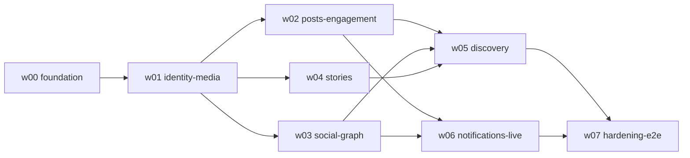

# Product Waves — insta-test (Instagram-like photo & video sharing)

> Step 2 plan for spec `spn_01M7MK8KQS1TR68R1BC5N49ENS` (branch `spec/spn_01M7MK8KQS1TR68R1BC5N49ENS` → `main`).
> Machine-readable DAG: [`WAVE_MANIFEST.json`](./WAVE_MANIFEST.json). Per-wave briefs: [`waves/`](./waves/).
> Source of truth for every contract is [`docs/specs/`](../specs/README.md). Read [AGENTS.md](../../AGENTS.md) before executing any task.

## Goal

A full analogue of a photo/video social network with a modern design: feed, photo/video publishing, user profiles,
follows, likes, comments, search, 24-hour stories and live notifications. The work is split into 8 waves that run
**in parallel at two levels**:

- **Between waves:** a dependency DAG. Waves with no path between them have pairwise disjoint `owned_paths`, so they run
  at the same time in separate git worktrees and separate Docker Compose port blocks.
- **Within a wave:** `WNN-01` (`contracts`) → parallel `worker` tasks with disjoint `owned_paths` → `WNN-K` (`validate`).

Every task in the manifest uses `mode: "exec"`, because every task builds or tests: `contracts` tasks install the
workspace, compile `@insta/contracts`, run mapper/VM unit tests or `validate-specs`; `worker` tasks run their unit and
integration tests; `validate` tasks run `wave-validate`, lint, the test suites and the compose smoke check.

## Wave Overview

| Wave | Slug | Depends on | Workers (parallel) | Scope summary |
|---|---|---|---|---|
| [`w00`](./waves/W00-foundation.md) | foundation | — | 3 | Workspace, `@insta/contracts` (all DTOs/events), schema v1 (`0001_init.sql`), domain kernel + ports + stubs, API/web platforms, Dockerfiles, compose, CI |
| [`w01`](./waves/W01-identity-media.md) | identity-media | w00 | 4 | Signup/login/logout/me/profile, media upload + serving + cleanup job, notification write side, web auth + edit profile |
| [`w02`](./waves/W02-posts-engagement.md) | posts-engagement | w01 | 3 | Posts CRUD + user grid, likes, comments, web composer + post detail + post components |
| [`w03`](./waves/W03-social-graph.md) | social-graph | w01 | 2 | Follow/unfollow, followers/following lists, web follow button + lists |
| [`w04`](./waves/W04-stories.md) | stories | w01 | 2 | Stories, tray, seen marks, viewers, story cleanup job, web tray + viewer + create |
| [`w05`](./waves/W05-discovery.md) | discovery | w02, w03, w04 | 3 | Home feed, explore, search, hashtags; web home/explore/search/hashtag/profile pages |
| [`w06`](./waves/W06-notifications-live.md) | notifications-live | w02, w03 | 3 | Notification list/unread/read, SSE ticket + stream + hub, web activity page, live badge, toasts |
| [`w07`](./waves/W07-hardening-e2e.md) | hardening-e2e | w05, w06 | 2 | Spec reconciliation, counter-integrity + index tests, architecture tests, Playwright e2e + a11y in CI |

## Dependency Graph



### Execution levels (critical path: w00 → w01 → w02 → w05 → w07)

| Level | Waves running concurrently | Notes |
|---|---|---|
| L0 | `w00` | Freezes all shared contracts and registries |
| L1 | `w01` | Identity and auth are needed by every later endpoint test |
| L2 | `w02` ∥ `w03` ∥ `w04` | Disjoint module prefixes (posts / social / stories) |
| L3 | `w05` ∥ `w06` (and `w06` may start while `w04` is still running) | `w06` does not depend on `w04` |
| L4 | `w07` | Final integration, e2e and spec reconciliation |

**No-stacking rule:** each wave branches from `main` (`wave/wNN-<slug>`) only after all of its `depends_on` waves have
landed on `main` through `wave-land`. Waves never branch from other wave branches.

## Why the Waves Are Cut This Way

1. **Contracts first, once.** The specs fully define every DTO, error code, event, table and port. `w00` freezes all
   of them (`packages/contracts`, `0001_init.sql`, `domain/**/ports.ts`, entity/read-model type declarations, Row types)
   so feature waves never edit a shared file at the same time.
2. **Stubs + registries remove shared-file edits.** `w00` creates every route module (empty Fastify plugin) listed in
   `api/routes/index.ts`, every service class skeleton, every pg repository stub, both job stubs in `jobs/index.ts`,
   every page placeholder in `ui/pages/index.ts`, and wires all of them in `main.ts` / `App.tsx`. A feature wave only
   replaces stub bodies inside its own files; `main.ts`, `App.tsx`, `routes/index.ts`, `pages/index.ts`, `package.json`
   and lockfile are not edited by feature waves.
3. **Auth and SQL-level fixtures live in `w00`.** Bearer-session resolution and the test harness (SQL-level factories
   for every table + `createAuthedUser`) are part of the platform. Workers inside a wave can therefore write integration
   tests for their endpoints without waiting for a sibling worker (e.g. likes tests do not need `POST /posts`).
4. **Notification writes come before engagement.** Likes, comments and follows create notifications *inside* their
   transactions (`F-BE-08`). The write side (`insertIfAbsent`, `deleteFor`) lands in `w01` so `w02` and `w03` can run in
   parallel; the read side, API and SSE land in `w06`.
5. **Pages that combine modules come last.** `HomePage` (story tray + feed) and `ProfilePage` (follow button + post grid)
   compose components from `w02`–`w04`, so they belong to `w05`.

## Frozen Module File Map (owned-path vocabulary)

`w00`/`W00-01` documents this map in `docs/specs/specs/01-project-structure.md`. Feature waves own files by these names.

| Module | Domain (`apps/api/src/domain/<m>/`) | Data (`apps/api/src/data/{rows,mappers,repositories}/`) | Routes (`apps/api/src/api/routes/`) | Wave |
|---|---|---|---|---|
| identity | `*.entity.ts`, `views.ts`, `identity.service.ts` | `users.*`, `sessions.*` | `identity.routes.ts` (auth, me, `GET /users/{username}`) | w01 |
| media | `*.entity.ts`, `media.service.ts` | `media.*` | `media.routes.ts` (`POST /media`, `GET /media/*`) | w01 |
| posts | `*.entity.ts`, `views.ts`, `post.service.ts`, `like.service.ts`, `comment.service.ts` | `posts.*`, `likes.*`, `comments.*` | `posts.routes.ts`, `likes.routes.ts`, `comments.routes.ts` | w02 |
| social | `*.entity.ts`, `views.ts`, `follow.service.ts` | `follows.*` | `social.routes.ts` | w03 |
| stories | `*.entity.ts`, `views.ts`, `story.service.ts` | `stories.*` | `stories.routes.ts` | w04 |
| feed | `views.ts`, `feed.service.ts` | `feed.*` (FeedQueries) | `feed.routes.ts` | w05 |
| search | `views.ts`, `search.service.ts` | `search.*` (SearchQueries) | `search.routes.ts` (incl. `GET /hashtags/{tag}/posts`) | w05 |
| notifications | `*.entity.ts` (w01), `views.ts`, `notification.service.ts` (w06) | `notifications.*` (write w01, read w06) | `notifications.routes.ts` | w01 / w06 |
| events (SSE) | — | — | `events.routes.ts` + `api/sse/` | w06 |

Tests: `apps/api/test/unit/<area>/`, `apps/api/test/integration/<area>/`, mapper tests in
`apps/api/test/unit/mappers/<table>*`. Platform adapters without a spec'd folder (argon2 hasher, token generator,
UUIDv7 generator) live in `apps/api/src/data/crypto/` (added to the structure spec by `W00-01`).

Web: `apps/web/src/api/*` (complete typed client) and `state/mappers/*` are created in `w00`; feature waves own
`ui/pages/<Page>*`, `ui/components/<Component>*`, `state/<module>*` hooks and their module's `state/mappers/<m>*`.

## Shared-Resource Rules

| Resource | Rule |
|---|---|
| `package.json` files, `package-lock.json` | Owned by `w00` only. `W00-01` installs the full toolchain baseline. A feature wave needing a new dependency records a gap instead. |
| Migrations | `0001_init.sql` (w00) creates the whole schema. Feature waves reserve **no** numbers. `0002_hardening.sql` is reserved for `w07`, used only for a confirmed index/constraint gap. |
| `docs/specs/**` | Feature waves `w01`–`w06` do not edit specs (several spec files span concurrent waves). Contract divergences go to `docs/questions-and-limitations/wNN-gaps.md`; `w07`/`W07-01` folds resolved gaps back into the specs. `w00` edits only `docs/specs/specs/01-project-structure.md`. |
| `packages/contracts/src/dto/<m>.ts` | Assigned per wave (see manifest). Changes must stay additive and spec-backed. `events.ts` → `w06`. |
| `.env.example`, env vars | Complete in `w00`; no new variables in feature waves. |
| Gap ledgers / checks | Each wave owns `docs/questions-and-limitations/wNN-*`, `docs/plan/checks/wNN-*`, `.yardos/waves/wNN`. |

## Per-Wave Compose & Port Strategy

Each wave preview runs an isolated copy of `docker-compose.yml` generated by `wave-compose-deploy`
(`.yardos/waves/<wNN>/compose.wave.yml` + `.env.wave`, gitignored) with project name `yd-insta-<wNN>` and a 20-port block
`21000 + slot*20`. `db` keeps no host port. The `api` reads `PUBLIC_URL` / `PUBLIC_API_URL` / `CORS_ORIGIN` for its block.

| Wave | Slot | Port block | `web` (offset 0) | `api` (offset 1) | Compose project |
|---|---|---|---|---|---|
| w00 | 0 | 21000–21019 | 21000 | 21001 | `yd-insta-w00` |
| w01 | 1 | 21020–21039 | 21020 | 21021 | `yd-insta-w01` |
| w02 | 2 | 21040–21059 | 21040 | 21041 | `yd-insta-w02` |
| w03 | 3 | 21060–21079 | 21060 | 21061 | `yd-insta-w03` |
| w04 | 4 | 21080–21099 | 21080 | 21081 | `yd-insta-w04` |
| w05 | 5 | 21100–21119 | 21100 | 21101 | `yd-insta-w05` |
| w06 | 6 | 21120–21139 | 21120 | 21121 | `yd-insta-w06` |
| w07 | 7 | 21140–21159 | 21140 | 21141 | `yd-insta-w07` |

```sh
node .yardos/skills/wave-compose-deploy/scripts/compose-wave.mjs --root . --project insta --wave w02 --slot-index 2 --render-only --json
node .yardos/skills/wave-compose-deploy/scripts/compose-wave.mjs --root . --project insta --wave w02 --slot-index 2 --up --json
node .yardos/skills/wave-compose-deploy/scripts/compose-wave.mjs --root . --project insta --wave w02 --down --json
```

## Definition of Done (every wave)

1. Spec-first: no undocumented endpoint, column, event, error code or env var. Gaps recorded in `wNN-gaps.md`.
2. `npm run lint`, `npm run typecheck`, `npm test`, `npm run test:integration` (from w01 on), `npm run build` pass.
3. Every new endpoint has integration tests: happy path + one auth failure + one validation failure, with response
   bodies parsed by the `@insta/contracts` schema.
4. Every new mapper has a round-trip unit test; domain + mapper line coverage ≥ 80 %.
5. Wave preview comes up healthy on its port block; `docs/plan/checks/wNN-check.md` lists manual checks for the owner.
6. `validate` task produced `docs/questions-and-limitations/wNN-gaps.md`, `docs/plan/checks/wNN-check.md`,
   `.yardos/waves/wNN/review-packet.json`.

## Feature Traceability Matrix

### Orchestrator feature groups

| Group ID | Meaning | Waves |
|---|---|---|
| `F-CORE-1` | Layered monorepo structure & architecture | w00, w07 |
| `F-CORE-2` | Three-layer entity mapping (DTO ↔ Entity ↔ Row) | w00, w01, w02, w03, w04 |
| `F-UI-1` | Modern, minimal, accessible UI | w00, w02, w04, w05, w07 |
| `F-INFRA-1` | Docker, compose, per-wave isolation, CI | w00, w07 |
| `F-FRONTEND-1` | React SPA workflows | w00–w06 |
| `F-BACKEND-1` | Business entities, services, handlers, jobs | w00–w06 |
| `F-PERSISTENCE-1` | PostgreSQL schema, migrations, indexes, row mappers | w00, w01, w02, w05, w07 |
| `F-INTERNAL-1` | Contracts package, domain events, SSE | w00, w06 |
| `F-EXTERNAL-1` | REST `/api/v1` API | w00–w06 |

### Spec feature IDs (100 % coverage)

| Feature | Wave / task(s) |
|---|---|
| `F-CORE-01` Layered monorepo skeleton | W00-01, W00-05, W07-04 |
| `F-CORE-02` Layer dependency rule | W00-01 (ESLint rule), W00-05, W07-02 |
| `F-CORE-03` Three-layer entity mapping | W00-01, W01-01, W02-01, W03-01, W04-01, W05-01, W06-01, W07-01 |
| `F-CORE-04` Public prefixed IDs | W00-01, W01-01, W07-01 |
| `F-CORE-05` Uniform error model | W00-02, W07-01 |
| `F-FE-01` App shell & routing | W00-03 |
| `F-FE-02` Auth pages | W01-05 |
| `F-FE-03` Home feed | W05-04 |
| `F-FE-04` Post composer | W02-04 |
| `F-FE-05` Post detail | W02-04 |
| `F-FE-06` Profile | W03-03, W05-04 |
| `F-FE-07` Edit profile | W01-05 |
| `F-FE-08` Explore & search | W05-04 |
| `F-FE-09` Stories | W04-03 |
| `F-FE-10` Notifications | W06-04 |
| `F-FE-11` Theming & a11y | W00-03, W07-03 |
| `F-FE-12` Runtime config | W00-03 |
| `F-BE-01` Identity & sessions | W01-02 |
| `F-BE-02` Media handling | W01-03 |
| `F-BE-03` Posts | W02-02 |
| `F-BE-04` Likes & comments | W02-03 |
| `F-BE-05` Follows | W03-02 |
| `F-BE-06` Stories | W04-02 |
| `F-BE-07` Feed, explore & search | W05-02, W05-03 |
| `F-BE-08` Notifications | W01-04 (write side), W06-02 |
| `F-BE-09` Scheduled jobs | W01-03 (media cleanup), W04-02 (story cleanup) |
| `F-BE-10` Thin handlers | W00-02 |
| `F-DB-01` Schema v1 | W00-01 |
| `F-DB-02` Forward-only migrations | W00-02 |
| `F-DB-03` Index coverage | W05-02, W05-03, W07-02 |
| `F-DB-04` Row mappers | W01-01, W02-01, W03-01, W04-01 |
| `F-DB-05` Counter integrity | W07-02 |
| `F-ICOMM-01` Shared contracts package | W00-01, W06-01 |
| `F-ICOMM-02` In-process domain event bus | W00-02 |
| `F-ICOMM-03` SSE stream with ticket auth | W06-03 |
| `F-ICOMM-04` Live notification delivery | W06-03 |
| `F-ICOMM-05` Client reconciliation | W06-04 |
| `F-ECOMM-01` API conventions | W00-02 |
| `F-ECOMM-02` Auth API | W01-02 |
| `F-ECOMM-03` Profiles API | W01-02, W03-02 |
| `F-ECOMM-04` Media API | W01-03 |
| `F-ECOMM-05` Posts API | W02-02 |
| `F-ECOMM-06` Likes & comments API | W02-03 |
| `F-ECOMM-07` Follows API | W03-02 |
| `F-ECOMM-08` Stories API | W04-02 |
| `F-ECOMM-09` Feed & explore API | W05-02 |
| `F-ECOMM-10` Search API | W05-03 |
| `F-ECOMM-11` Notifications API | W06-02 |
| `F-ECOMM-12` No third-party integrations | W00-02, W00-04 (CI grep gate), W07-02 |
| `F-INFRA-01` API image | W00-04 |
| `F-INFRA-02` Web image | W00-04 |
| `F-INFRA-03` Compose stack | W00-04, W00-05 |
| `F-INFRA-04` Per-wave isolation | W00-04, W00-05 |
| `F-INFRA-05` Env configuration | W00-02, W00-04 |
| `F-INFRA-06` CI gates | W00-04, W07-03 |
| `F-INFRA-07` Health probes | W00-02 |

## Planning Notes & Open Points

These are planning decisions that go beyond the current spec text. The named task records each one in its wave gap
ledger and, where needed, `W00-01` / `W07-01` updates the spec.

| # | Point | Decision in this plan | Recorded by |
|---|---|---|---|
| P-1 | Module file names (route files per sub-resource, `*.entity.ts`, `views.ts`, `data/crypto/`) are not fixed by the spec. | Use the frozen file map above; document it in `01-project-structure.md`. | W00-01 |
| P-2 | `SseTicketResponseDto` lives in `dto/auth.ts` (w01) but `POST /events/ticket` is implemented in `events.routes.ts` (w06). | Keep the DTO in w01; w06 consumes it. | W06-03 |
| P-3 | Spec says logout closes the session's SSE streams, but there is no `SessionRevoked` domain event. | `SseHub` re-checks the session at each 25 s heartbeat and closes revoked streams; no new event. | W06-03 |
| P-4 | Playwright config/spec location is not in the structure spec. | `apps/web/e2e/` + `apps/web/playwright.config.ts`. | W07-03 |
| P-5 | Integration tests for `GET /hashtags/{tag}/posts` need the feed adapter from a sibling worker. | W05-03 unit-tests with a fake `FeedQueries`; integration test is green after merge in W05-05. | W05-03 |
| P-6 | Existing open questions `Q-01`…`Q-08` stay out of scope for v1 as proposed in the ledger. | No wave implements them. | — |
